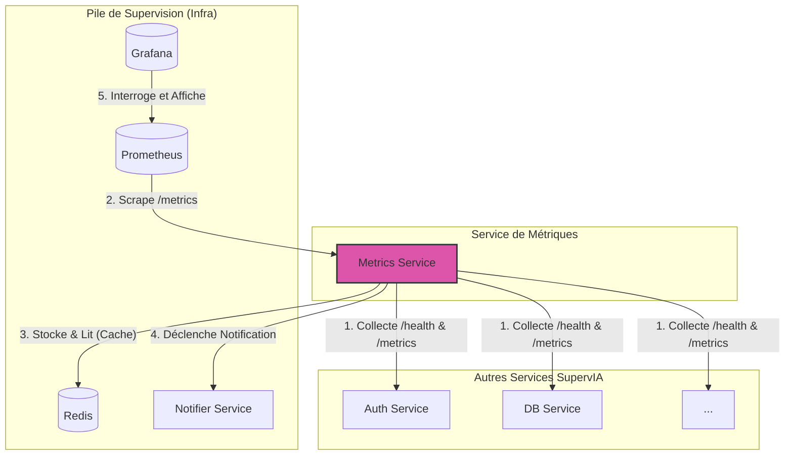

# 📊 SupervIA Metrics Service - Service de Métriques et d'Alerting

[](https://github.com/zkerkeb-class/metrics-service-Tadayoshi123)
[](https://nodejs.org/)
[](./LICENSE)

> **Microservice central pour la collecte, l'exposition, et la surveillance des métriques de l'écosystème SupervIA.**

Ce service agit comme le "système nerveux" de la supervision. Il collecte périodiquement les métriques des autres microservices, les expose dans un format compatible avec [Prometheus](https://prometheus.io/), et déclenche des alertes lorsque les seuils prédéfinis sont dépassés.

---

## 📋 Table des matières

1.  [**Fonctionnalités Clés**](#-fonctionnalités-clés)
2.  [**Architecture & Flux**](#-architecture--flux)
3.  [**Installation et Lancement**](#-installation-et-lancement)
    -   [Prérequis](#prérequis)
    -   [Configuration (.env)](#configuration-env)
    -   [Déploiement avec Docker](#déploiement-avec-docker-recommandé)
4.  [**Documentation de l'API**](#-documentation-de-lapi)
    -   [Endpoints Publics (Monitoring)](#endpoints-publics-monitoring)
    -   [Endpoints Privés (API REST)](#endpoints-privés-api-rest)
5.  [**Système d'Alerting**](#-système-dalerting)
6.  [**Sécurité**](#-sécurité)
7.  [**Scripts Utiles**](#-scripts-utiles)
8.  [**Variables d'Environnement**](#-variables-denvironnement)

---

## ✨ Fonctionnalités Clés

-   **Collecte Centralisée** : Interroge périodiquement les endpoints `/metrics` et `/health` des autres microservices SupervIA.
-   **Exposition pour Prometheus** : Fournit un endpoint `/metrics` standard pour que Prometheus puisse "scraper" les données agrégées.
-   **API REST Robuste** : Permet d'interroger l'état actuel et l'historique des métriques des services.
-   **Système d'Alerting** :
    -   Évalue les métriques collectées par rapport à des seuils configurables (ex: usage CPU, temps de réponse).
    -   Déclenche des alertes avec différents niveaux de sévérité (`info`, `warning`, `error`, `critical`).
    -   Envoie des notifications (Email, Slack, etc.) lorsqu'une alerte est active ou résolue.
-   **Mise en Cache Redis** : Utilise Redis pour stocker temporairement l'état des métriques et des alertes, améliorant les performances.
-   **Configuration Flexible** : Les services à surveiller et leurs seuils d'alerte sont facilement configurables dans le fichier `src/config/services.js`.
-   **Sécurité** : Protège les endpoints sensibles de l'API via une authentification JWT.

## 🏗️ Architecture & Flux

Ce service s'intègre au cœur de la pile de supervision, aux côtés de Prometheus et Grafana.



1.  **Collecte** : Le `CollectorService` interroge les autres services à intervalle régulier.
2.  **Exposition** : Les données collectées sont formatées et exposées sur le endpoint `/metrics` du `Metrics Service`. Prometheus scrape ce endpoint.
3.  **Mise en Cache** : Les états et alertes sont mis en cache dans Redis pour un accès rapide.
4.  **Alerting** : L'`AlertService` vérifie les métriques. Si un seuil est dépassé, il déclenche une alerte et peut appeler le `Notifier Service` pour envoyer un message.
5.  **Visualisation** : Grafana se connecte à Prometheus comme source de données pour afficher les dashboards.

## 🚀 Installation et Lancement

### Prérequis
- **Node.js** : `v18.0.0` ou supérieure
- **npm** : `v8.0.0` ou supérieure
- **Docker & Docker Compose** (recommandé pour l'écosystème complet)

### Configuration (.env)
1.  **Copiez le modèle** : `cp .env.example .env`
2.  **Modifiez `.env`** : Assurez-vous que toutes les variables sont correctement configurées, notamment :
    -   Les URLs des autres services (`AUTH_SERVICE_URL`, `DB_SERVICE_URL`, etc.).
    -   L'URL de Prometheus (`PROMETHEUS_URL`).
    -   L'URL et la base de données de Redis (`REDIS_URL`, `REDIS_DB`).
    -   Le secret JWT (`JWT_SECRET`), qui doit être partagé avec les autres services.
    -   Les configurations de notification d'alerte (`ENABLE_EMAIL_ALERTS`, `SLACK_WEBHOOK_URL`, etc.).

### Déploiement avec Docker (Recommandé)

Le service est conçu pour être lancé via le `docker-compose.yml` principal du projet `infra`.

```bash
# Depuis la racine du projet SupervIA (avec le docker-compose.yml principal)
docker-compose up -d --build supervia-metrics-service

# Pour voir les logs
docker-compose logs -f supervia-metrics-service

# Pour arrêter
docker-compose down
```

## 📖 Documentation de l'API

### Endpoints Publics (Monitoring)

Ces endpoints sont conçus pour être utilisés par des outils de supervision comme Kubernetes ou Prometheus.

| Méthode | Endpoint     | Description                                                                                               |
| ------- | ------------ | --------------------------------------------------------------------------------------------------------- |
| `GET`   | `/health`    | Vérifie la santé globale du service et de ses dépendances (Redis).                                        |
| `GET`   | `/liveness`  | Sonde de vivacité simple. Retourne 200 si le service est en cours d'exécution.                            |
| `GET`   | `/readiness` | Sonde de préparation. Retourne 200 si le service est prêt à accepter du trafic.                          |
| `GET`   | `/metrics`   | **Endpoint principal pour Prometheus.** Expose toutes les métriques collectées au format Prometheus.      |

### Endpoints Privés (API REST)

Toutes ces routes sont préfixées par `/api/v1` et nécessitent un **token JWT** valide pour l'authentification.

#### Métriques

| Méthode | Endpoint                          | Description                                                                                              |
| ------- | --------------------------------- | -------------------------------------------------------------------------------------------------------- |
| `GET`   | `/metrics`                        | Retourne les métriques actuelles de tous les services surveillés.                                         |
| `GET`   | `/metrics/:serviceId`             | Retourne les métriques d'un service spécifique.                                                          |
| `GET`   | `/metrics/:serviceId/history`     | Retourne l'historique des métriques pour un service (filtres `startDate`, `endDate` disponibles).         |
| `POST`  | `/metrics/collect`                | **(Admin)** Force la collecte immédiate des métriques pour tous les services.                            |

#### Alertes

| Méthode | Endpoint                     | Description                                                                               |
| ------- | ---------------------------- | ----------------------------------------------------------------------------------------- |
| `GET`   | `/alerts`                    | Retourne toutes les alertes actives. Filtres possibles : `serviceId`, `severity`.         |
| `GET`   | `/alerts/:alertId`           | Retourne les détails d'une alerte spécifique.                                             |
| `POST`  | `/alerts`                    | **(Admin)** Crée manuellement une alerte.                                                 |
| `DELETE`| `/alerts/:alertId`           | **(Admin)** Marque une alerte comme résolue.                                              |

## 🚨 Système d'Alerting

-   **Configuration** : Les seuils d'alerte pour chaque service sont définis dans `src/config/services.js`.
-   **Vérification** : Le `AlertsService` s'exécute à un intervalle défini par `ALERTS_CHECK_INTERVAL` pour évaluer les métriques.
-   **Notifications** : Lorsqu'une alerte est déclenchée, le `notification.service` est appelé pour envoyer des notifications par e-mail ou Slack, si activé dans le fichier `.env`.

## 🔐 Sécurité

Les endpoints de l'API REST (`/api/v1/*`) sont protégés. Un client doit présenter un **token JWT** valide dans l'en-tête `Authorization: Bearer <token>`. Le rôle (`admin`, `user`) contenu dans le token est utilisé pour contrôler l'accès aux endpoints sensibles (ex: forcer la collecte de métriques).

## 🛠️ Scripts Utiles

-   `npm run dev`: Démarre le serveur en mode développement avec `nodemon`.
-   `npm test`: Lance la suite de tests avec `jest`.
-   `npm run generate-jwt`: Génère un nouveau secret JWT aléatoire (pour `JWT_SECRET`).
-   `npm run swagger:gen`: Régénère le fichier `src/swagger.json`.

## ⚙️ Variables d'Environnement

Consultez le fichier `.env.example` pour une liste exhaustive.

| Variable                      | Description                                                                     | Exemple                               |
| ----------------------------- | ------------------------------------------------------------------------------- | ------------------------------------- |
| `PORT`                        | Port d'écoute du service.                                                       | `3003`                                |
| `REDIS_URL`                   | URL de connexion au serveur Redis.                                              | `redis://supervia-redis:6379/2`       |
| `JWT_SECRET`                  | Secret partagé pour la validation des JWT.                                      | `un_secret_tres_long_et_complexe`     |
| `PROMETHEUS_URL`              | URL de l'instance Prometheus.                                                   | `http://prometheus:9090`              |
| `*_SERVICE_URL`               | URLs des autres microservices pour la collecte de métriques.                    | `http://auth-service:3001`            |
| `ALERT_RECIPIENT_EMAIL`       | E-mail destinataire pour les notifications d'alerte.                            | `admin@supervia.com`                  |
| `METRICS_COLLECTION_INTERVAL` | Intervalle de collecte des métriques (en ms).                                   | `60000` (60 secondes)                 |
| `ALERTS_CHECK_INTERVAL`       | Intervalle de vérification des alertes (en ms).                                 | `300000` (5 minutes)                  |
| `ENABLE_EMAIL_ALERTS`         | Active (`true`) ou désactive (`false`) les notifications par e-mail.            | `true`                                |
| `SLACK_WEBHOOK_URL`           | URL du webhook Slack pour les notifications.                                    | `https://hooks.slack.com/services/...`|

---
**SupervIA** - Projet de certification RNCP - Expert en Développement Full Stack. 